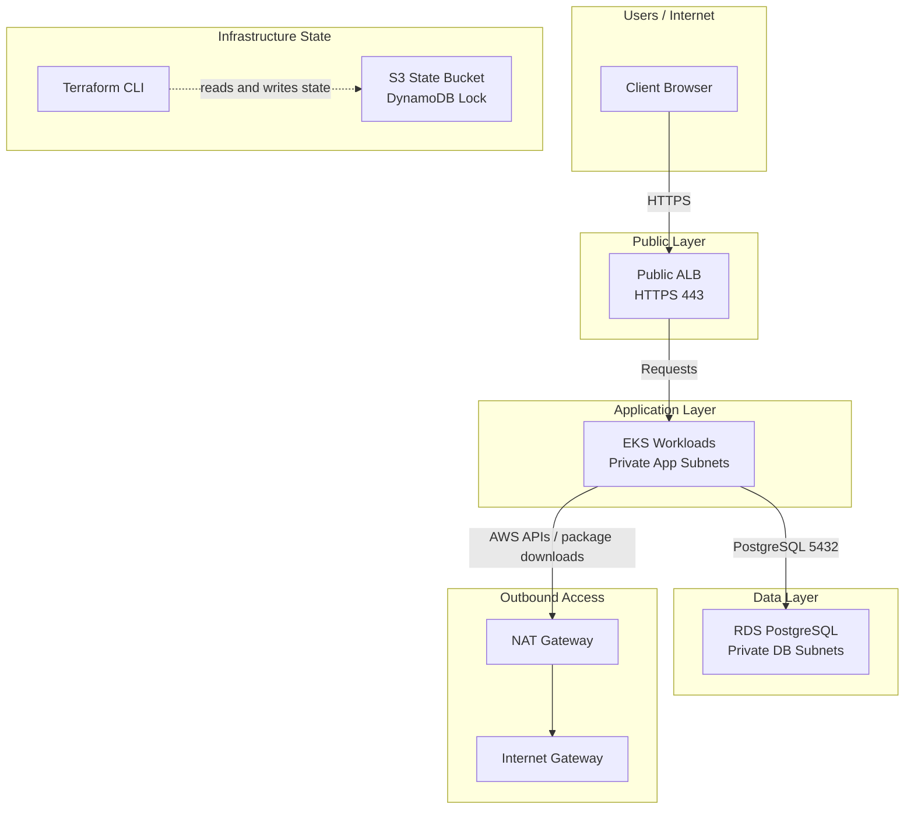

# Architecture: AWS Merchant Platform

## Overview

This deployment uses a simple three-layer AWS design in `eu-west-1` across two Availability Zones:

- A public layer for internet access
- A private application layer for EKS workloads
- A private data layer for PostgreSQL

The key idea is that only the load balancer is exposed to the internet. The application and database remain private by design.

## How the traffic flows

1. Users reach the platform through a public Application Load Balancer over HTTPS.
2. The ALB forwards traffic to EKS workloads running in private application subnets.
3. The application connects to RDS PostgreSQL in private database subnets.
4. EKS nodes use a NAT gateway for outbound access to AWS services and the internet.
5. Terraform manages infrastructure state remotely in S3 with a DynamoDB lock table.

## Topology Diagram

## Key design points

- Public subnet: ALB and NAT are placed here.
- Private app subnets: EKS worker nodes run here.
- Private DB subnets: RDS PostgreSQL stays here with no public exposure.
- Terraform state: Remote state is stored in S3 and protected by DynamoDB locking.
